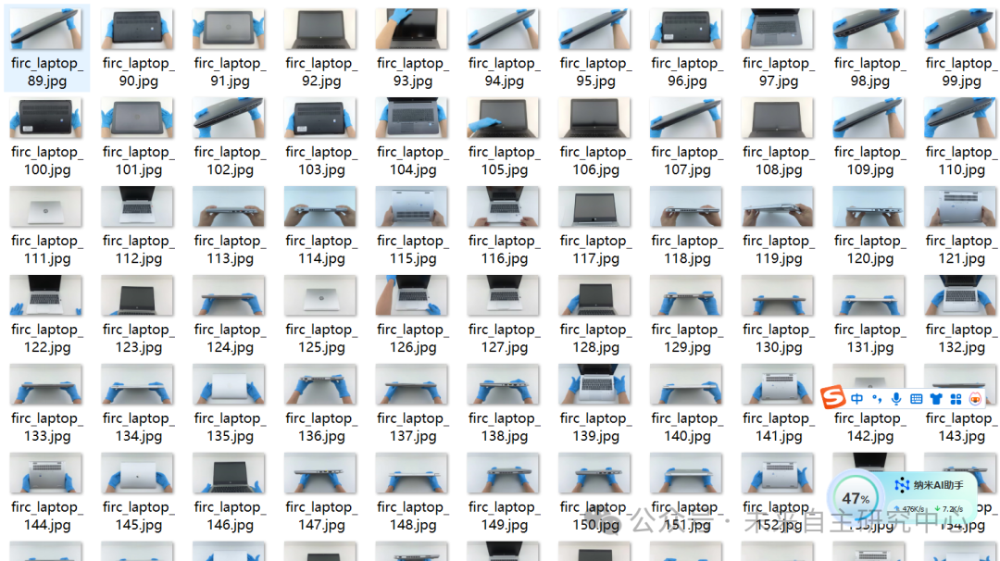
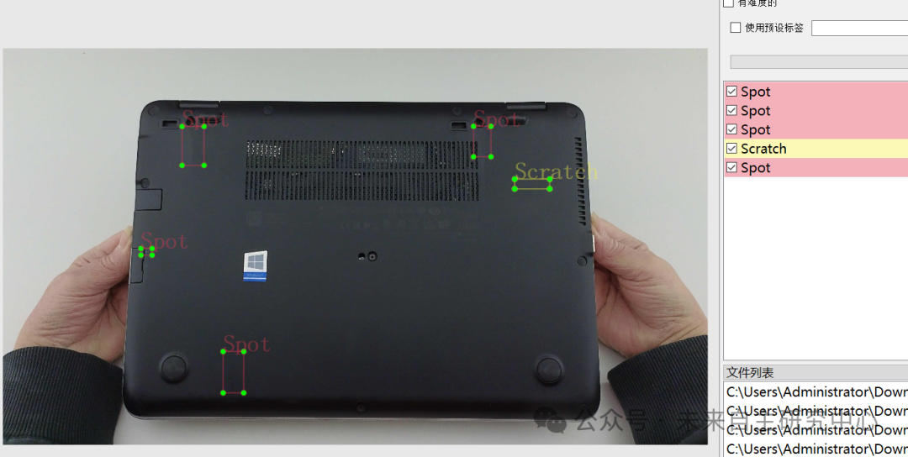

# Laptop Defect Detection Dataset VOC+YOLO format with 1395 images in 1 category

Important Notice: This is a normal phenomenon for the accuracy of small object detection training models to be relatively low.

Dataset format: Pascal VOC format + YOLO format (txt file without split path, only containing jpg images and corresponding VOC format xml files and yolo format txt files)

Number of images (number of jpg files): 1395

Number of annotations (number of xml files): 1395

Number of annotations (number of txt files): 1395

Label category count: 5

Annotation category names: ["Broken", "Crack", "Dent", "Scratch", "Spot"]

Number of boxes labeled in each category:

Broken Frames = 124

Crack Frames = 55

Dent frame count = 3340

Scratch Frame Count = 3287

Spot Frames = 7113

Total frame count: 13919

Using labelImg:

Annotation rules: Draw a rectangle around the category.

Important Notice: No

Special : This dataset does not guarantee the accuracy or precision of the trained models or weight files. The dataset is provided with accurate and reasonable annotations only.

Image Preview:

Annotation example:

## Payment

Here is a pay link on Stripe ( https://buy.stripe.com/3cs8yP7sY87d0vu9AB ). Please contact me lonlonago@foxmail.com after funding $89, and I will send you a complete data files , thank you!

